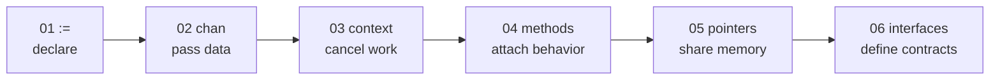

# Go basics, one note per concept

These notes explain the six things that confused you in Stage 0. Read them in
order. Each note is short, has a diagram, and ends with a self check.

| # | File | One line |
| --- | --- | --- |
| 1 | [01-short-variable-declaration.md](01-short-variable-declaration.md) | `:=` declares a variable and infers its type. |
| 2 | [02-channels.md](02-channels.md) | `chan` is a typed pipe between goroutines. `<-` moves data through it. |
| 3 | [03-context.md](03-context.md) | `context.Context` carries cancel and deadline. It is `AbortController`. |
| 4 | [04-methods-and-receivers.md](04-methods-and-receivers.md) | `func (r *T) M()` is a method. The receiver is `this`. |
| 5 | [05-pointers.md](05-pointers.md) | `*T` is an address. `&x` takes it, `*p` follows it. |
| 6 | [06-interfaces-and-embedding.md](06-interfaces-and-embedding.md) | An interface is a contract. Embedding reuses methods. |

## How to read a note

Every note has the same shape:

1. **What it is.** One paragraph, plain words.
2. **The web comparison.** The Express or JS thing it replaces.
3. **The diagram.** A picture of the moving parts.
4. **The code.** Small, complete, runnable.
5. **Common mistakes.** The errors you will hit.
6. **Self check.** Three questions. If you can answer them, you know it.

## The one idea behind all six

Go makes the machine visible. JavaScript hides pointers, threads, and
cancellation behind objects and promises. Go shows them as `*`, `chan`, and
`context`. That is more typing now, and fewer surprises later.

