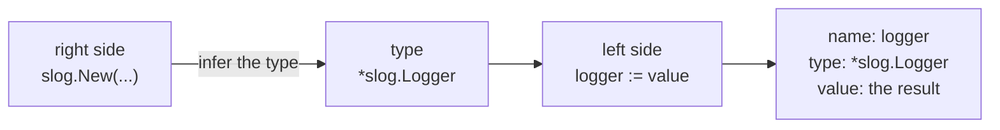

# 1. `:=` short variable declaration

## What it is

`:=` declares a new variable and gives it a value. Go reads the type from the
value on the right. You do not write the type.

```go
logger := slog.New(slog.NewTextHandler(os.Stdout, nil))
```

Read it as: "make a variable named `logger`, and its type is whatever
`slog.New(...)` returns."

## The web comparison

In JavaScript you write `const logger = ...`. The type is inferred too, but JS
types are loose and can change at runtime. In Go the type is fixed at compile
time and can never change.

```js
let x = 1;      // JS
x = "hello";    // legal in JS
```

```go
x := 1          // Go, x is int
x = "hello"     // compile error, x is int forever
```

## The diagram



The compiler looks at the right side, finds the type, then binds the name to
that type and value.

## The three forms

| Form | Where | Example | Meaning |
| --- | --- | --- | --- |
| `:=` | inside a function only | `n := 5` | declare and assign, type inferred |
| `var` | anywhere | `var n int` | declare, zero value, type written |
| `=` | anywhere | `n = 5` | assign to an existing variable |

The zero value is the default for a type: `0` for numbers, `""` for strings,
`false` for bool, `nil` for pointers, slices, maps, channels, and interfaces.

## The code

```go
package main

import "fmt"

func main() {
	name := "Ada"        // string
	age := 36            // int
	score := 9.5         // float64
	ok := true           // bool

	var count int        // declared, zero value 0
	count = 3            // assigned later

	fmt.Println(name, age, score, ok, count)
}
```

## Rules you must remember

1. `:=` only works inside a function. At package level use `var`.
2. The left side must contain at least one new name.
3. You cannot change the type later.
4. `:=` with an existing name in the same scope is a compile error.

```go
x := 1
x := 2   // error: no new variables on left side of :=
x = 2    // correct
```

## Common mistakes

**Mistake 1. Using `:=` at package level.**

```go
package main

x := 1   // error: non-declaration statement outside function body
```

Fix: `var x = 1`.

**Mistake 2. Shadowing.** A `:=` inside a block makes a new variable that hides
the outer one.

```go
err := doThing()
if true {
	err := doOther()   // NEW err, hides the outer one
	_ = err
}
// outer err is still the first one
```

This bites hard with `err`. Watch for it.

**Mistake 3. Expecting a type change.**

```go
n := 1
n = "one"   // compile error
```

## Self check

1. Why does `x := 1` then `x := 2` fail?
2. What is the zero value of a `string`?
3. Where can you not use `:=`?

Answers: it declares twice with no new name; `""`; at package level.
