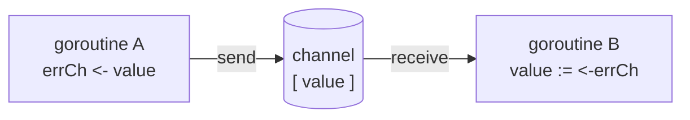

# 2. `chan` and `<-`

## What it is

A channel is a typed pipe between two goroutines. A goroutine is a lightweight
thread that Go schedules for you. One side sends a value into the pipe. The
other side receives it. Both sides block until the other is ready.

```go
errCh := make(chan error, 1)
```

`make` builds it. `error` is the type of value it carries. `1` is the buffer
size.

## The web comparison

There is no direct JS equivalent. The closest ideas:

- A promise that resolves once. But a channel can be reused many times.
- An event emitter with one listener. But a channel blocks instead of firing.
- A queue with a fixed size. This is the closest.

Think of it as a one-slot mailbox. The sender drops a letter in. The receiver
takes it out. If the box is full, the sender waits. If the box is empty, the
receiver waits.

## The diagram



The arrow always points in the direction the data moves.

## Send and receive

```go
ch <- 42        // SEND 42 into ch
v := <-ch       // RECEIVE from ch into v
```

Read the arrow as "data flows toward the arrow".

- `ch <- x` : the arrow points at the channel. Data goes in.
- `<-ch` : the arrow points away from the channel. Data comes out.

## Buffered and unbuffered

```go
unbuffered := make(chan int)      // buffer 0
buffered   := make(chan int, 3)   // buffer 3
```

| Kind | Send blocks when | Receive blocks when |
| --- | --- | --- |
| unbuffered | no receiver is waiting | no sender is waiting |
| buffered | the buffer is full | the buffer is empty |

An unbuffered channel is a handshake. Both sides must meet.

## The code

```go
package main

import "fmt"

func main() {
	ch := make(chan string, 1)

	go func() {
		ch <- "done"   // send from a goroutine
	}()

	msg := <-ch        // receive in main
	fmt.Println(msg)   // done
}
```

## Why Stage 0 uses a channel

`ListenAndServe` blocks forever. It never returns while the server runs. So we
run it in a goroutine and let it report back through a channel.

```go
errCh := make(chan error, 1)

go func() {
	errCh <- srv.ListenAndServe()   // blocks, then sends the error
}()

select {
case err := <-errCh:   // server stopped on its own
	// handle err
case <-ctx.Done():     // Ctrl+C arrived
	// shut down
}
```

The buffer of 1 matters. If the server fails before `main` reaches the
`select`, the goroutine can still send and exit. With an unbuffered channel it
would block forever and leak.

## `select`

`select` waits on several channels at once. The first one ready wins.

```go
select {
case v := <-a:
	fmt.Println("a", v)
case v := <-b:
	fmt.Println("b", v)
}
```

This is `Promise.race` in JS, but it can run forever and it can be reused.

## Closing a channel

```go
close(ch)
```

Only the sender closes. A receive from a closed channel returns the zero value
immediately. A send to a closed channel panics. Do not close a channel you do
not own.

## Common mistakes

**Mistake 1. Deadlock.** Send with no receiver, or receive with no sender.

```go
ch := make(chan int)
ch <- 1   // fatal error: all goroutines are asleep - deadlock!
```

**Mistake 2. Send on a closed channel.** This panics.

**Mistake 3. Forgetting the buffer.** A goroutine that sends and then exits
can block forever if nobody receives.

**Mistake 4. Using a channel where a plain variable is enough.** Channels are
for passing data between goroutines. For one value read after a wait, a
`sync.WaitGroup` or a simple function call is simpler.

## Self check

1. What does `ch <- 1` do, and what does `<-ch` do?
2. Why is `make(chan error, 1)` buffered in Stage 0?
3. What happens if you send to a closed channel?

Answers: send and receive; so the goroutine never blocks if `main` is slow;
it panics.
