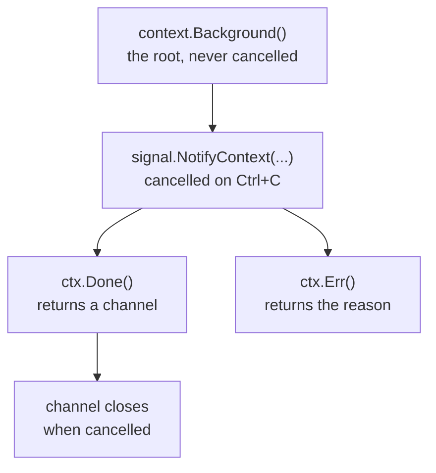

# 3. `context.Context`

## What it is

A context is a value that carries two things: a cancellation signal and a
deadline. You pass it down a call chain. When it is cancelled, every function
that watches it stops work.

```go
ctx, stop := signal.NotifyContext(context.Background(), os.Interrupt)
defer stop()
```

## The web comparison

`context.Context` is `AbortController` and its `signal`.

```js
const ctrl = new AbortController();
fetch(url, { signal: ctrl.signal });
ctrl.abort();   // cancels the fetch
```

```go
ctx, cancel := context.WithCancel(context.Background())
doWork(ctx)
cancel()        // tells doWork to stop
```

The difference: in Go you pass `ctx` as the first argument to every function
that might block. In JS you pass `signal` in an options object. Same idea.

## The diagram



`ctx.Done()` is a channel. It closes when the context is cancelled. A closed
channel is always ready to receive. So `<-ctx.Done()` unblocks at cancel time.

## The three things you do with a context

**1. Watch it.**

```go
select {
case <-ctx.Done():
	return ctx.Err()
case result := <-work:
	return result
}
```

**2. Derive a child with a timeout.**

```go
shutdownCtx, cancel := context.WithTimeout(context.Background(), 10*time.Second)
defer cancel()
srv.Shutdown(shutdownCtx)
```

The child is cancelled when the parent is cancelled, or when the timeout
fires, whichever comes first.

**3. Pass it down.** The first parameter of a blocking function is `ctx`.

```go
func fetchUser(ctx context.Context, id int) (*User, error)
```

## The code

```go
package main

import (
	"context"
	"fmt"
	"time"
)

func main() {
	ctx, cancel := context.WithTimeout(context.Background(), 100*time.Millisecond)
	defer cancel()

	select {
	case <-time.After(1 * time.Second):
		fmt.Println("work finished")
	case <-ctx.Done():
		fmt.Println("cancelled:", ctx.Err())   // context deadline exceeded
	}
}
```

The work takes one second. The deadline is 100 ms. The context wins.

## Why Stage 0 uses it

```go
ctx, stop := signal.NotifyContext(context.Background(), os.Interrupt, syscall.SIGTERM)
defer stop()
```

`signal.NotifyContext` returns a context that is cancelled when the process
gets Ctrl+C or a terminate signal. `defer stop()` releases the signal handler
when `main` returns. `defer` is `try/finally`.

Then:

```go
select {
case err := <-errCh:
	// server stopped by itself
case <-ctx.Done():
	// Ctrl+C arrived
}
```

`main` waits on two channels. Whichever fires first wins.

## Rules

1. `ctx` is the first parameter, named `ctx`. Never store it in a struct.
2. Always call the `cancel` function. Use `defer cancel()`.
3. Never pass `nil` as a context. Use `context.Background()` or
   `context.TODO()`.
4. A context is immutable. `WithTimeout` returns a new one, it does not change
   the old one.

## Common mistakes

**Mistake 1. Forgetting `cancel`.** This leaks a timer and a goroutine.

```go
ctx, cancel := context.WithTimeout(context.Background(), time.Second)
// no defer cancel()  -> leak
```

**Mistake 2. Storing the context in a struct.** Pass it as an argument.

**Mistake 3. Using `context.Background()` deep in a call chain.** It breaks
cancellation. Pass the `ctx` you were given.

**Mistake 4. Ignoring `ctx.Done()` in a loop.** A long loop must check it.

## Self check

1. What does `ctx.Done()` return?
2. Why is `defer cancel()` required?
3. What is the difference between `WithCancel` and `WithTimeout`?

Answers: a channel that closes on cancel; to free the timer and goroutine;
`WithTimeout` also cancels after a duration.
