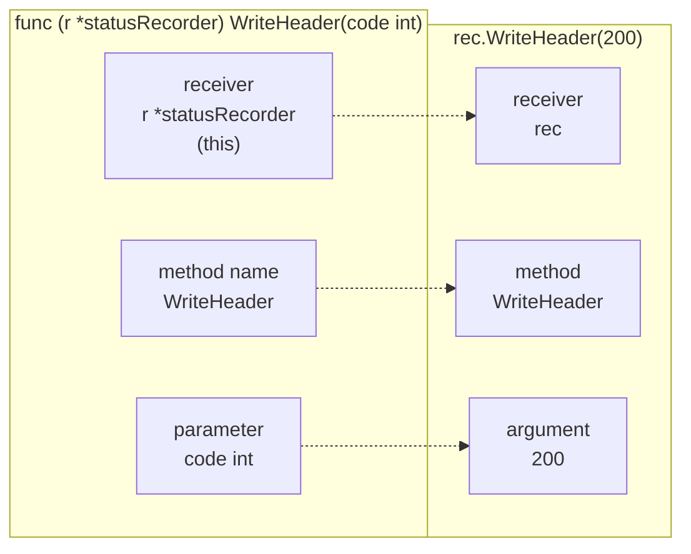

# 4. Methods and receivers

## What it is

A method is a function that belongs to a type. The type is written in
parentheses before the method name. That part is the **receiver**.

```go
func (r *statusRecorder) WriteHeader(code int) {
	r.status = code
	r.ResponseWriter.WriteHeader(code)
}
```

Read it as: "the method `WriteHeader` on `*statusRecorder`, taking one `int`."

## The web comparison

The receiver is `this`.

```js
class StatusRecorder {
  writeHeader(code) {
    this.status = code;   // this is the receiver
  }
}
```

In JS `this` is implicit and can change. In Go the receiver is explicit and
named. You choose the name, here `r`. It is always the first thing in the
signature.

## The diagram



The receiver is not an argument. It is the value the method is called on. Go
passes it automatically.

## Function vs method

```go
// function: no receiver
func writeJSON(w http.ResponseWriter, status int, v any) { ... }

// method: has a receiver
func (r *statusRecorder) WriteHeader(code int) { ... }
```

A function is called `writeJSON(w, 200, v)`. A method is called
`rec.WriteHeader(200)`. The receiver moves to the left of the dot.

## Value receiver vs pointer receiver

```go
func (r statusRecorder) Status() int   // value receiver: gets a COPY
func (r *statusRecorder) Set(n int)    // pointer receiver: gets the ADDRESS
```

| Receiver | Sees changes made inside? | Can change the caller's value? |
| --- | --- | --- |
| value `T` | no, it has a copy | no |
| pointer `*T` | yes, same struct | yes |

Rule of thumb: if the method changes the struct, use a pointer receiver. If
the struct is small and read only, a value receiver is fine. Be consistent per
type.

## Why `WriteHeader` must be a pointer method

`logRequests` reads `rec.status` after the handler runs.

```go
rec := &statusRecorder{ResponseWriter: w, status: http.StatusOK}
next.ServeHTTP(rec, r)
logger.Info("request", "status", rec.status)   // must see the new value
```

The handler calls `rec.WriteHeader(500)`. That sets `r.status = 500`. Because
`r` is a pointer to the same struct, `rec.status` is now 500. With a value
receiver, the write would land on a copy and `rec.status` would stay 200.

## Why the signature is exactly `WriteHeader(code int)`

`http.ResponseWriter` is an interface. It declares:

```go
WriteHeader(statusCode int)
```

Your method must match that name and that parameter list to satisfy the
interface. The receiver is not part of the match. So `func (r *statusRecorder)
WriteHeader(code int)` fits, and `func (r *statusRecorder) WriteHeader(code
string)` does not.

## The code

```go
package main

import "fmt"

type Counter struct {
	n int
}

func (c *Counter) Add() {   // pointer receiver: changes c
	c.n++
}

func (c Counter) Value() int {   // value receiver: reads a copy
	return c.n
}

func main() {
	c := &Counter{}
	c.Add()
	c.Add()
	fmt.Println(c.Value())   // 2
}
```

## Common mistakes

**Mistake 1. Value receiver on a mutating method.**

```go
func (c Counter) Add() { c.n++ }   // changes a copy, lost
```

**Mistake 2. Mixing receiver names.** Use the same short name on every method
of a type. `r` everywhere, not `r` then `rec` then `self`.

**Mistake 3. Calling a pointer method on a non-addressable value.** Go fixes
this for variables, but not for map values or function results.

**Mistake 4. Thinking the receiver is an argument.** It is not. `WriteHeader`
takes one argument, not two.

## Self check

1. In `func (r *statusRecorder) WriteHeader(code int)`, how many arguments does
   the method take?
2. Why does `statusRecorder` need a pointer receiver?
3. What is the receiver in JS terms?

Answers: one, `code`; so the status write is visible to the caller; `this`.
