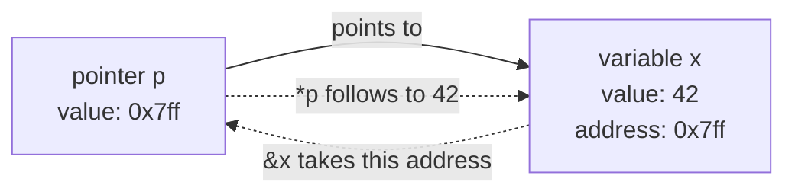

# 5. Pointers

## What it is

A pointer is a value that holds the memory address of another value. It does
not hold the data. It holds where the data lives.

```go
p := &x     // p is a pointer to x
*p = 10     // follow p, write 10 into x
```

Two operators:

- `&x` takes the address of `x`. Read as "address of x".
- `*p` follows the pointer. Read as "the value at p".

The type `*T` means "pointer to T".

## The web comparison

In JavaScript every object is a reference. You never see the address, but it
is there.

```js
const a = { n: 1 };
const b = a;      // b points at the same object
b.n = 2;
console.log(a.n); // 2
```

Go does the same thing, but you write the `*` and `&` yourself. Numbers,
strings, and structs are copied by default. Pointers make sharing explicit.

## The diagram



## Copy vs share

```go
type Point struct{ X, Y int }

func byValue(p Point)  { p.X = 99 }   // changes a copy
func byPointer(p *Point) { p.X = 99 } // changes the original

func main() {
	p := Point{X: 1, Y: 2}
	byValue(p)
	fmt.Println(p.X)   // 1, unchanged
	byPointer(&p)
	fmt.Println(p.X)   // 99, changed
}
```

| Pass | What the function gets | Can it change the caller's value? |
| --- | --- | --- |
| `Point` | a copy | no |
| `*Point` | the address | yes |

## Why Stage 0 uses a pointer

```go
rec := &statusRecorder{ResponseWriter: w, status: http.StatusOK}
next.ServeHTTP(rec, r)
```

`rec` is a pointer. The handler receives the same struct. When it calls
`WriteHeader`, the write lands on the real struct. Then `logRequests` reads
`rec.status` and sees the new value.

If `rec` were a value, the handler would get a copy, and the log would always
say 200.

## `nil`

The zero value of a pointer is `nil`. It points at nothing.

```go
var p *Point   // p is nil
fmt.Println(p.X)   // panic: nil pointer dereference
```

Always check before you follow a pointer that might be nil.

## When to use a pointer

Use a pointer when:

1. The function must change the value.
2. The struct is large and copying is expensive.
3. You need to say "no value" and `nil` is the natural way.

Use a value when the data is small and read only.

## The code

```go
package main

import "fmt"

type User struct {
	Name string
}

func rename(u *User) {
	u.Name = "Grace"
}

func main() {
	u := User{Name: "Ada"}
	rename(&u)
	fmt.Println(u.Name)   // Grace
}
```

Note: `u.Name` works on a pointer. Go follows the pointer for you. You do not
need `(*u).Name`.

## Common mistakes

**Mistake 1. Nil dereference.** Following a nil pointer panics.

**Mistake 2. Taking the address of a loop variable.** In old Go this was a
classic bug. Go 1.22 and later give each loop iteration a new variable, so it
is fixed. Still, be aware of the pattern.

**Mistake 3. Returning a pointer to a local variable and worrying.** Go moves
it to the heap for you. This is safe.

**Mistake 4. Using pointers everywhere.** It adds noise. Use them when you
need sharing or mutation.

## Self check

1. What does `&x` do, and what does `*p` do?
2. Why does `rename(&u)` change `u` but `rename(u)` would not?
3. What is the zero value of a pointer?

Answers: take the address, follow the pointer; it passes the address, not a
copy; `nil`.
