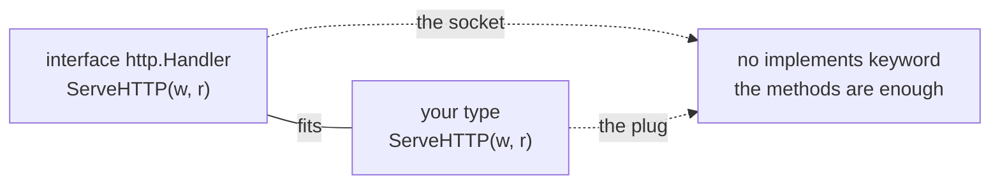
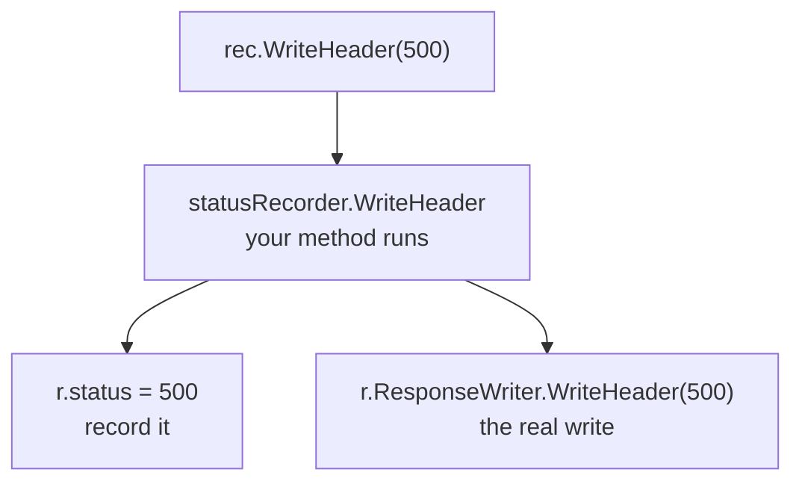

# 6. Interfaces and embedding

## What it is

An interface is a contract. It lists method names and signatures. Any type
that has all those methods satisfies the interface. You never say "implements".
Go checks it for you.

```go
type Handler interface {
	ServeHTTP(w ResponseWriter, r *Request)
}
```

Any type with a `ServeHTTP` method that matches is a `Handler`.

## The web comparison

An interface is a TypeScript `interface`, but with no `implements` keyword.

```ts
interface Handler {
  serveHTTP(w: ResponseWriter, r: Request): void;
}
```

In TS a class must say `implements Handler`. In Go it just has to have the
methods. This is called **structural typing**: the shape is the contract.

## The diagram



## The two interfaces in Stage 0

**`http.Handler`** is the thing the server calls.

```go
type Handler interface {
	ServeHTTP(ResponseWriter, *Request)
}
```

**`http.ResponseWriter`** is the thing you write the response into.

```go
type ResponseWriter interface {
	Header() Header
	Write([]byte) (int, error)
	WriteHeader(statusCode int)
}
```

Your `statusRecorder` has all three methods, because it embeds a real
`ResponseWriter` and overrides one. So it is a `ResponseWriter`.

## `http.HandlerFunc` is an adapter

A plain function is not a `Handler`. It has no method. `HandlerFunc` fixes
that.

```go
type HandlerFunc func(ResponseWriter, *Request)

func (f HandlerFunc) ServeHTTP(w ResponseWriter, r *Request) {
	f(w, r)
}
```

`HandlerFunc` is a function type with a `ServeHTTP` method. The method calls
the function. So any function with the right shape becomes a `Handler` when you
wrap it.

```go
mux.HandleFunc("GET /test", handleTest)   // mux wraps handleTest for you
```

This is the Go version of `app.get("/test", handleTest)`.

## Embedding

Embedding is a field with no name. It gives the outer type every method of the
inner type.

```go
type statusRecorder struct {
	http.ResponseWriter   // embedded, no field name
	status int
}
```

`statusRecorder` now has `Header`, `Write`, and `WriteHeader` for free. It
satisfies `http.ResponseWriter` without writing those methods.

Then you override one:

```go
func (r *statusRecorder) WriteHeader(code int) {
	r.status = code
	r.ResponseWriter.WriteHeader(code)
}
```

The override records the code, then calls the embedded writer's own method.
The other two methods still come from the embedded field.

## The diagram of the override



## The code

```go
package main

import "fmt"

type Speaker interface {
	Speak() string
}

type Dog struct{}

func (d Dog) Speak() string { return "woof" }

type Robot struct{}

func (r Robot) Speak() string { return "beep" }

func announce(s Speaker) {
	fmt.Println(s.Speak())
}

func main() {
	announce(Dog{})     // woof
	announce(Robot{})   // beep
}
```

`Dog` and `Robot` never mention `Speaker`. They just have the method. That is
enough.

## Common mistakes

**Mistake 1. A nil interface with a non-nil value inside.** A typed nil pointer
stored in an interface is not `nil`. This is a classic trap. Check the concrete
value, not the interface.

**Mistake 2. Forgetting a method.** If one method is missing or has the wrong
signature, the type does not fit. The compiler error names the missing method.

**Mistake 3. Overusing interfaces.** Define an interface where you consume it,
not where you produce it. Small interfaces are better. `http.Handler` has one
method.

**Mistake 4. Embedding to reuse code when you mean composition.** Embedding
promotes methods. If you only need a field, use a named field.

## Self check

1. Does a type need to say `implements` to satisfy an interface?
2. What does embedding `http.ResponseWriter` give `statusRecorder`?
3. Why does `http.HandlerFunc` exist?

Answers: no, the methods are enough; `Header`, `Write`, and `WriteHeader`; to
turn a plain function into a `Handler`.

## The big picture

Go's HTTP stack is one interface, `http.Handler`, and one method,
`ServeHTTP(w, r)`. The mux is a handler. Your function is a handler. The logger
wrapper is a handler that calls another handler. That is why middleware
composes: everything is the same type.

Express passes `(req, res, next)` and mutates shared objects. Go passes two
values and returns nothing. State travels through the `ResponseWriter` and the
`Request`, not through a shared mutable object. This is why Stage 8 can wrap
the writer to record the status, exactly as `statusRecorder` does now.
